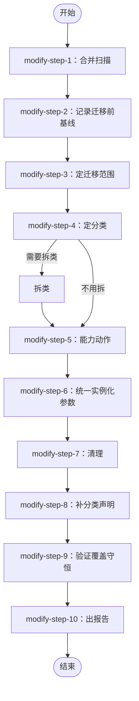
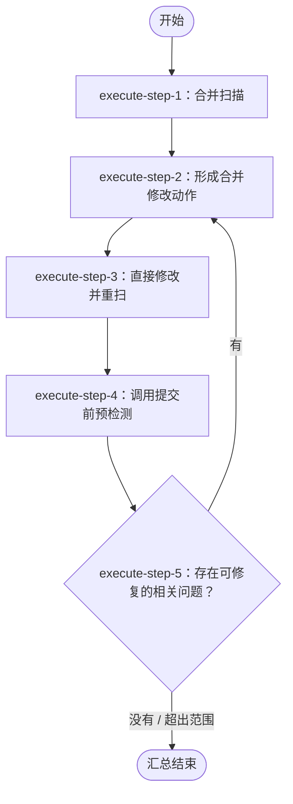
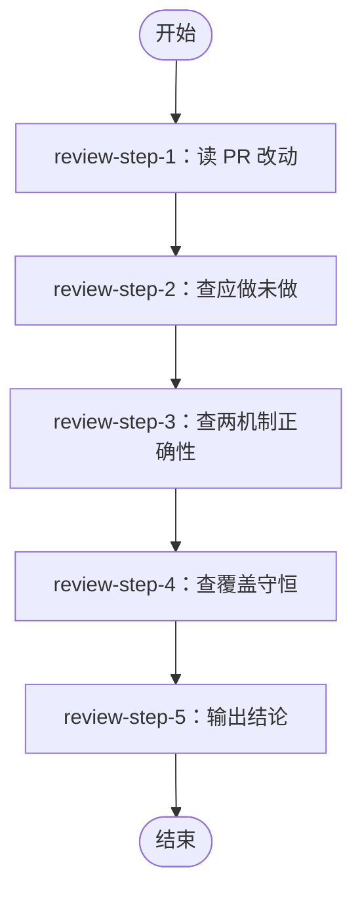
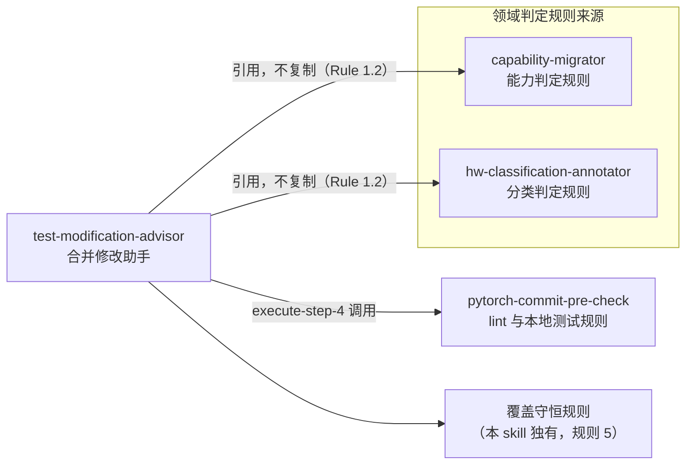
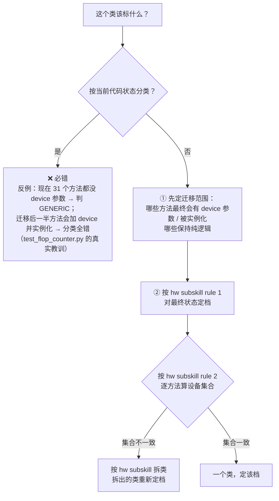
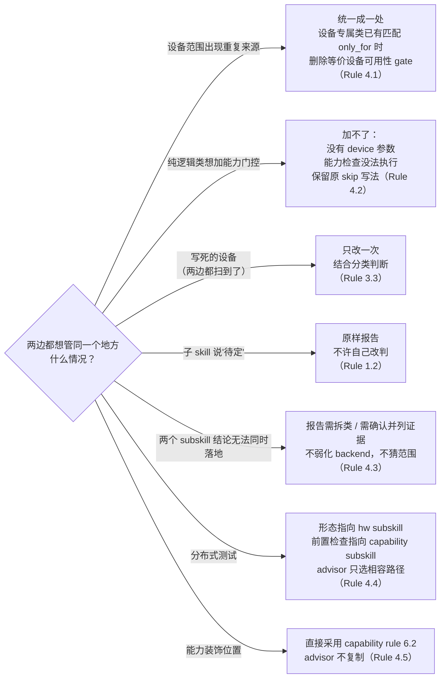
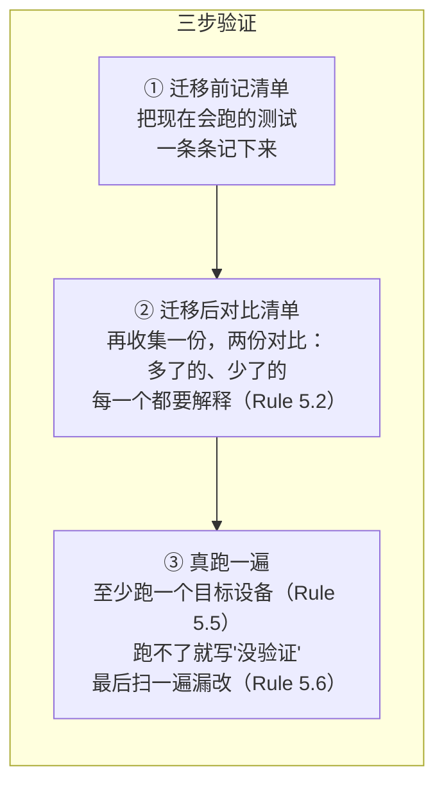

# test-modification-advisor 规则与流程图

> 这个 skill 协调同一份测试文件的能力门控（`@requires_capabilities`）与硬件分类（`hw_classification`），支持 modify、execute、review 三种模式。
> 领域判定规则不在这里：能力判定看 capability-migrator，硬件分类看 hw-classification-annotator；execute 的 lint 与本地测试看 pytorch-commit-pre-check。advisor 只维护两套迁移规则的交互、覆盖守恒和执行流程衔接。

## 规则总表

### 规则 1：分工

> 先说人话：能力门控和硬件分类是两套各管各的东西——一个管方法（"这个测试需要什么能力"），一个管类（"这个类是什么硬件类型"），互补不冲突。

| 编号 | 规则 |
|---|---|
| Rule 1.1 | 能力门控管**方法**（"这个测试需要什么能力"）；硬件分类管**类**（"这个类是什么硬件类型"）。互补，不冲突 |
| Rule 1.2 | 判定规则指向两个子 skill，不复制；子 skill 给出的"待定"结论，这里原样报告，不许重新定性 |

### 规则 2：分类的时机（最容易错的地方）

> 先说人话：用户给的文件是改到一半的状态。分类必须按"改完之后长什么样"来定，按"现在长什么样"定必错。

| 编号 | 规则 |
|---|---|
| Rule 2.1 | 先确定哪些方法会被迁移（迁移后会有 `device` 参数、会被实例化），**再按迁移完成后的状态**标分类。按当前半成品状态分类必错 |
| Rule 2.2 | 逐方法设备集合、拆类条件和分类值全部采用 hw subskill 的 rule 1 / rule 2；advisor 只把结论回流到实例化与能力动作 |

### 规则 3：编辑顺序

> 先说人话：改一份文件要按固定顺序来，乱序会返工——比如先标了分类再改方法，分类就错了。

| 编号 | 规则 |
|---|---|
| Rule 3.1 | 固定顺序：先记录基线 → 再定范围 → 再定分类 → 再做能力动作 → 统一实例化参数 → 清理 → 补分类声明 → 验证覆盖。顺序不能乱 |
| Rule 3.2 | `only_for`/`except_for` 一次定稿：同时满足分类约束和设备 flag 的范围，不许两套规则各改各的 |
| Rule 3.3 | 写死的设备两套机制只出一次修改，别改两遍 |

### 规则 4：冲突处理

先说人话：一份文件要同时满足两套规则，有些地方**两边都管**。撞车时的原则就一条：**能合就合成一次修改，不能合就明说不行，不许和稀泥**。

| 编号 | 规则 |
|---|---|
| Rule 4.1 | 设备范围只保留一个来源：设备专属类已有匹配的 `only_for` 时，等价设备可用性 gate 不再以方法装饰器重复表达 |
| Rule 4.2 | hw 判为纯逻辑 `GENERIC`、而 capability 机制缺少可求值 harness 时，保留原 skip 语义，不强塞能力门控 |
| Rule 4.3 | 两个 subskill 的结论无法同时落地时，报告“需拆类 / 需确认”并列出冲突证据，不弱化精确 backend、不猜设备范围 |
| Rule 4.4 | 分布式类的目标形态由 hw subskill 决定；对应前置检查由 capability subskill 决定。advisor 只选择相容路径，不复制领域细则 |
| Rule 4.5 | 能力装饰位置完全采用 capability subskill 的 rule 6.2，advisor 不维护镜像规则 |

### 规则 5：覆盖守恒

先说人话：迁移是"换个写法"，**不是"换一批测试"**。迁移之前会跑 100 个测试，迁移之后还得是这 100 个——不能悄悄变成 95 个，也不能悄悄变成 120 个。这就是覆盖守恒。

| 编号 | 规则 |
|---|---|
| Rule 5.1 | 迁移前后，实际会跑的测试必须还是同一批：哪些测试、跑在哪些设备上、用什么参数，都不能悄悄变多或变少 |
| Rule 5.2 | 怎么确认：迁移前记一份"现在会跑哪些测试"的清单；迁移后再收集一份清单；两份对比，多出来的和消失的每一个都要解释清楚（对比脚本：`compare_collection_manifest.py`） |
| Rule 5.3 | 测试变多也是问题，不是白赚的。变多变少都要写明理由，不许默认"更多就是更好" |
| Rule 5.4 | 每个结论要注明你是凭什么说的：只是看代码推的 / 拿到测试清单了 / 真跑过了 / 确认不了。**不许把"我看代码觉得对"说成"我验证过了"** |
| Rule 5.5 | 缺目标硬件（比如手里没有 XPU）就老实写"没验证"，不许装通过 |
| Rule 5.6 | 收尾扫一遍有没有漏改的东西：旧 flag / import、多余的装饰器、没用的 device 参数、失效的 skip |

---

## 主流程 A：modify（给文件，出合并修改方案）

### 步骤说明

| 步骤 | 做什么 | 用到的规则 |
|---|---|---|
| modify-step-1 合并扫描 | 跑 `scan_combined.py`：能力发现 + 分类发现 + 两机制交叉点。外部脚本缺失就降级：直接读文件 + 对照子 skill 规则 | — |
| modify-step-2 记录迁移前基线 | 把现在会跑的测试记成清单：每个测试跑哪些设备 / 用什么参数 / skip 条件。确认不了的写"确认不了"，不猜 | rule 5.2 |
| modify-step-3 定迁移范围 | 哪些方法会被迁移（最终有 device 参数、被实例化），哪些保持纯逻辑 | — |
| modify-step-4 定分类 | ⚠️ 必须按迁移后的状态定，按当前半成品状态定必错；设备集合不一致要拆类。细节见模块 rule-2 | rule 2 |
| modify-step-5 能力动作 | 按能力子 skill 的规则：flag 分类、注册新能力、换装饰器、分布式 gate 替换 | 子 skill 规则 |
| modify-step-6 统一实例化参数 | `only_for`/`except_for` 一次定稿；两套规则撞车时按冲突规则处理，消解不了的报"需拆类/需确认"。细节见模块 rule-4 | rule 3.2、rule 4 |
| modify-step-7 清理 | 删散点 import、改写死的设备。⚠️ 两套机制只改一次 | rule 3.3 |
| modify-step-8 补分类声明 | 属性 + import + 约束修复。⚠️ 只加属性不算完成 | 子 skill 规则 |
| modify-step-9 验证覆盖守恒 | 三步：对比迁移前后的测试清单（增删都要解释）、真跑代表性设备、扫漏改。细节见模块 rule-5 | rule 5 |
| modify-step-10 出报告 | 按模板出报告，每类附可直接用的 before→after 代码；待核实项、不适用项单列 | — |

## 主流程 B：execute（直接修改并验证）

### 步骤说明

| 步骤 | 做什么 | 规则来源 |
|---|---|---|
| execute-step-1 合并扫描 | 按 modify-step-1 逐个扫描目标测试文件 | advisor modify 流程 |
| execute-step-2 形成合并修改动作 | 按 modify-step-2~8 完成基线、迁移范围、分类、能力动作、实例化参数与清理分析 | advisor rule 1~4 + 两个领域 subskill |
| execute-step-3 直接修改并重扫 | 在用户授权范围内落盘；逐文件重扫并按 modify-step-9 验证覆盖守恒；待定项不猜测修改 | advisor rule 5 |
| execute-step-4 调用提交前预检测 | 把仓库绝对路径、实际修改文件和用户选择的验证范围交给 `pytorch-commit-pre-check`；其环境、范围、lint、P0/P1、失败分类与产物规则全部引用该 subskill | `../pytorch-commit-pre-check/SKILL.md` |
| execute-step-5 汇总并闭环 | 汇总修改、残留、验证和待核实项；相关且在授权范围内的问题回到 step-2，其余按预检测结论报告 | advisor execute 流程 + 预检测 subskill |

## 主流程 C：review（给 PR，判断两套机制是否都符合）

### 步骤说明

每一步发现的问题都记入问题清单，最后一步汇总输出。

| 步骤 | 查什么 | 用到的规则 |
|---|---|---|
| review-step-1 读 PR 改动 | 以 PR 的改动内容为准，本地文件可能落后 | — |
| review-step-2 查应做未做 | 按两个子 skill 的"应做未做"规则分别扫：能力该迁没迁、分类该标没标 | 子 skill 规则 |
| review-step-3 查两机制正确性 | 按两个子 skill 的正确性规则检查能力用法、注册、分类值、约束，分两维度记录问题 | 子 skill 规则 |
| review-step-4 查覆盖守恒 | 细节见模块 rule-5 | rule 5 |
| review-step-5 输出结论 | 一句话结论（全对 / N 个问题），按类别列问题 + 怎么改，没问题的最后一句带过 | — |

### advisor 与 subskill 的关系

---

## 分模块：规则细节

### 模块 rule-2：分类必须按迁移后的状态定

### 模块 rule-4：冲突处理

### 模块 rule-5：覆盖守恒

验证就三步，一步一步做：

报告里每个结论都要标证据，四个档，只能往上不能跳级：

| 证据档 | 意思 |
|---|---|
| 推断 | 只看代码推出来的，没收集也没跑 |
| 有清单 | 收集到了测试清单（test ID） |
| 验证过 | 真跑过，至少一个目标设备/后端执行通过 |
| 确认不了 | 动态表达式、缺硬件等原因，下不了结论 |

## 规则出处

| 规则组 | 原始出处 |
|---|---|
| 规则 1 | `references/coordination-guide.md` §一 |
| 规则 2 | `references/coordination-guide.md` §二 |
| 规则 3 | `references/coordination-guide.md` §三 |
| 规则 4 | `references/coordination-guide.md` §四 |
| 规则 5 | `references/coverage-preservation.md` §一 |
